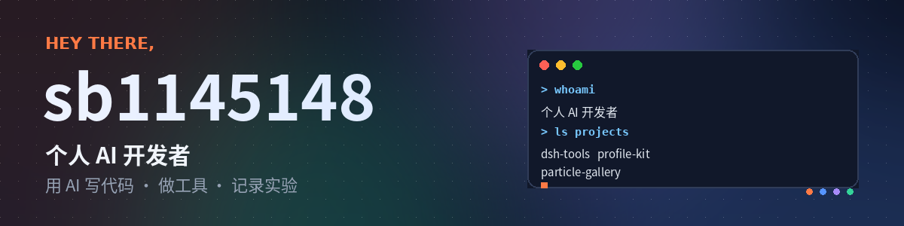
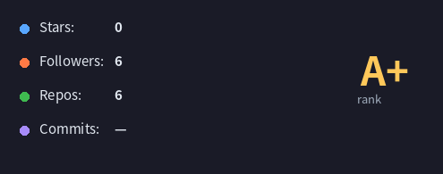
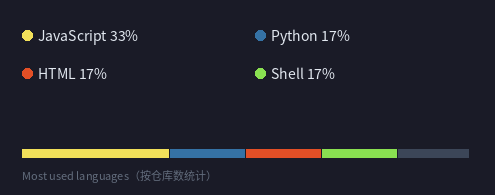

  

  

  
  
  

---

## 主推

### 🛠 [dsh-tools](https://github.com/sb1145148/dsh-tools)
`Shell`

给 DSHA 做能真的恢复回来的备份。两个命令，绕开应用自带备份的 `ARCHIVE_LINK_ESCAPE`。

  

### 🎨 [profile-kit](https://github.com/sb1145148/profile-kit)
`JavaScript`

开源个人博客模板。Cloudflare Pages + Workers + D1，零成本部署，MIT。

 

---

## 其他

### ✨ [particle-gallery](https://github.com/sb1145148/particle-gallery)
`JavaScript`

粒子效果相册，支持自定义图片。用 deepseek-harness 做的小实验。

### 💣 [minesweeper](https://github.com/sb1145148/minesweeper)
`HTML`

扫雷。用来验证「AI 能不能独立写完一个小游戏」。

---

## 在做的

- 让 AI 接管一部分开发流程：写代码、跑测试、部署，然后记录它错在哪
- 用公开数据做小规模观察实验，结论写进[站点](https://sb1145148.dpdns.org)
- 把踩过的坑做成能复用的工具，而不是留在对话记录里

---

## 统计

  

  

<!-- 备用：如果哪天卡片加载不出来，把上面两行换成下面两行（静态图，不会自动更新）

  
  

-->

---

## 贡献

  <picture>
    <source media="(prefers-color-scheme: dark)" srcset="https://raw.githubusercontent.com/sb1145148/sb1145148/output/snake-dark.svg" />
    
  </picture>

每天北京时间 11:00 由 Actions 重新生成。

---

  先让它跑起来，再问它为什么能跑。

  

